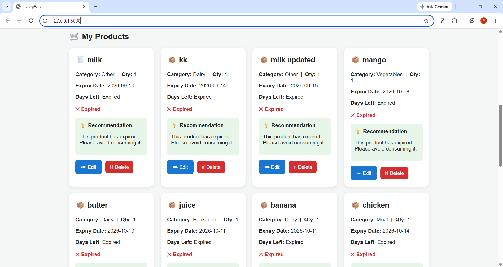
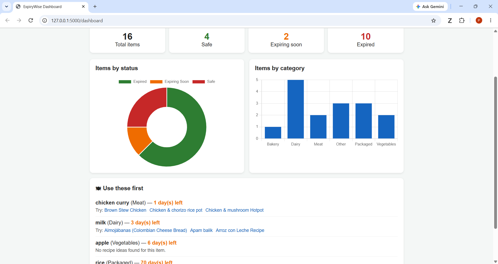
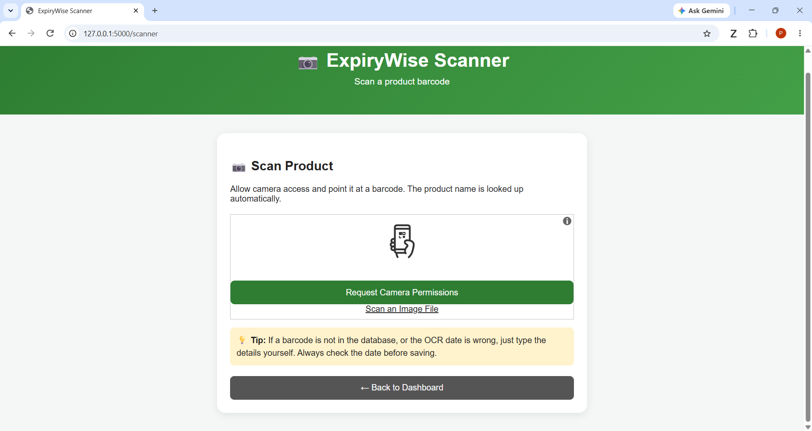

# ExpiryWise


**Smart Food Expiry Tracking and Food Waste Reduction System**

ExpiryWise is a Flask-based web application that helps users manage food and household product expiry dates. It reduces waste by tracking expiry dates, highlighting products that need attention, and suggesting how to use them.

It combines barcode lookup, OCR-based expiry date extraction, email reminders, recipe suggestions and a statistics dashboard in one platform.

---

## Problem Statement

A large amount of food is thrown away every year simply because people forget expiry dates. Products get buried in kitchen shelves and refrigerators, and by the time they are noticed, they have already expired.

ExpiryWise solves this by keeping all products and their expiry dates in one place, warning the user before a product expires, and suggesting what to cook or do with items that need attention.

---

## Screenshots

### Home Page


### Dashboard


### Barcode Scanner


---

## Project Status

| Phase | Scope | Status |
|-------|-------|--------|
| Phase 1 | Core product management and expiry tracking | Completed |
| Phase 2 | Barcode, OCR, reminders, recipes, dashboard, testing, CI | Completed |
| Phase 3 | Authentication, waste analytics, security hardening, Docker | Planned |

---

## Features

### Phase 1 – Core Features
- Add, view, edit and delete products.
- Track product expiry dates and calculate remaining days.
- Display **Safe**, **Expiring Soon** and **Expired** statuses.
- Search products by name and filter by status and category.
- Rule-based recommendations for every product.

### Phase 2 – Advanced Features
- Extended product details: category, quantity and barcode.
- Product lookup using the **Open Food Facts API**.
- Barcode scanning.
- OCR expiry date extraction from product images (**Tesseract**).
- Daily email reminders (**APScheduler + SMTP**).
- Category-aware recommendations.
- Dashboard with product statistics and charts.
- Recipe suggestions using the **TheMealDB API**.
- Input validation and centralized error handling.
- Automated tests (**pytest**) and Continuous Integration (**GitHub Actions**).

### Phase 3 – Planned Features

| # | Feature | Description |
|---|---------|-------------|
| 1 | User authentication | Register, login and logout. Each user sees only their own products. Passwords stored as hashes. |
| 2 | Mark as Used / Wasted | Users record what happened to a product instead of only deleting it. |
| 3 | Waste analytics | Monthly used vs wasted chart and waste percentage, built from the Used/Wasted records. |
| 4 | Security hardening | CSRF protection on all forms, `SECRET_KEY` from environment, `debug` off in production, secure session cookies. |
| 5 | CSV export | Download the product list as a CSV file. |
| 6 | Docker support | `Dockerfile` and `docker-compose.yml` so the app runs with one command, with Tesseract included. |
| 7 | Phase 3 tests | Automated tests for every item above (see [TESTING.md](docs/TESTING.md)). |

> Phase 3 is a plan. Items move to "Completed" only after the code is merged and its tests pass.

---

## Expiry Status Rules

| Status | Condition |
|--------|-----------|
| Safe | More than 5 days remaining |
| Expiring Soon | 0 to 5 days remaining |
| Expired | Expiry date has passed |

---

## Technology Stack

| Technology | Purpose |
|------------|---------|
| Python, Flask | Backend |
| SQLite | Database |
| HTML, CSS, JavaScript, Chart.js | Frontend and charts |
| Tesseract OCR, Pillow, pytesseract | Expiry date extraction |
| Open Food Facts API | Barcode product lookup |
| TheMealDB API | Recipe suggestions |
| APScheduler, SMTP | Email reminders |
| pytest, pytest-cov | Testing and coverage |
| GitHub Actions | Continuous Integration |
| Flask-Login, Flask-WTF (Phase 3) | Authentication and CSRF protection |
| Docker, gunicorn (Phase 3) | Deployment |

---

## Architecture

```text
                 USER
                   |
                   v
             WEB INTERFACE
          HTML / CSS / JavaScript
                   |
                   v
              FLASK APP (app.py)
                   |
       +-----------+-----------+
       |           |           |
       v           v           v
  PRODUCT       OCR       RECOMMENDATION
 MANAGEMENT   PROCESSING      MODULE
       |           |
       v           v
    SQLite     Tesseract
   Database
       |
       +-----------------------+
       |                       |
       v                       v
 BARCODE LOOKUP           RECIPE MODULE
 Open Food Facts           TheMealDB
       |
       v
 REMINDER MODULE (APScheduler + SMTP)
       |
       v
    DASHBOARD

 Phase 3 adds: AUTH layer (login) in front of the app,
 and an ANALYTICS module reading Used/Wasted records.
```

---

## Project Structure

```text
ExpiryWise/
├── .github/workflows/tests.yml
├── docs/
│   ├── screenshots/
│   │   ├── home.png
│   │   ├── dashboard.png
│   │   └── scanner.png
│   └── TESTING.md
├── templates/
├── tests/
│   ├── test_expirywise.py
│   └── test_error_handling.py
├── app.py
├── ocr.py
├── recommendation.py
├── recipes.py
├── reminders.py
├── error_handlers.py
├── requirements.txt
└── README.md
```

Phase 3 will add `auth.py`, `analytics.py`, `Dockerfile`, `docker-compose.yml` and `tests/test_phase3.py`.

---

## Installation and Setup

### 1. Clone and open the project

```bash
git clone https://github.com/prasanthika2008-lgtm/ExpiryWise.git
cd ExpiryWise
```

### 2. Create and activate a virtual environment

```bash
python -m venv venv
```

Windows:

```bash
venv\Scripts\activate
```

macOS / Linux:

```bash
source venv/bin/activate
```

### 3. Install dependencies

```bash
pip install -r requirements.txt
```

### 4. Install Tesseract OCR (needed only for OCR)

- Windows: https://github.com/UB-Mannheim/tesseract/wiki
- Ubuntu: `sudo apt install tesseract-ocr`
- macOS: `brew install tesseract`

If Tesseract is missing, the OCR endpoint returns a "service unavailable" response and the rest of the app still works.

### 5. Run the application

```bash
python app.py
```

Open http://127.0.0.1:5000

---

## Configuration (Environment Variables)

| Variable | Required | Purpose |
|----------|----------|---------|
| `SMTP_USER` | Optional | Email account used to send reminders |
| `SMTP_PASS` | Optional | Gmail App Password (not your normal password) |
| `REMINDER_TO` | Optional | Address that receives reminders |
| `SECRET_KEY` | Phase 3 | Session and CSRF signing key |

Never commit these values to the repository. Without `SMTP_USER` and `SMTP_PASS`, email reminders are simply disabled and the app runs normally.

Example (Windows PowerShell):

```powershell
$env:SMTP_USER="your@gmail.com"
$env:SMTP_PASS="your-app-password"
$env:REMINDER_TO="your@gmail.com"
python app.py
```

---

## API Endpoints

### Current

| Method | Endpoint | Description |
|--------|----------|-------------|
| GET | `/` | Home page |
| POST | `/` | Add product |
| GET/POST | `/edit/<id>` | Edit product |
| POST | `/delete/<id>` | Delete product |
| GET | `/scanner` | Scanner page |
| GET | `/dashboard` | Dashboard |
| GET | `/api/barcode/<code>` | Barcode lookup |
| POST | `/api/ocr` | OCR date extraction |
| GET | `/api/recipes/<product>` | Recipe suggestions |
| GET | `/api/stats` | Product statistics |

### Planned (Phase 3)

| Method | Endpoint | Description |
|--------|----------|-------------|
| GET/POST | `/register` | Create an account |
| GET/POST | `/login` | Log in |
| POST | `/logout` | Log out |
| POST | `/products/<id>/used` | Mark a product as used |
| POST | `/products/<id>/wasted` | Mark a product as wasted |
| GET | `/analytics` | Waste analytics page |
| GET | `/export.csv` | Download products as CSV |

---

## Testing

The project has **37 automated tests** covering product management, status rules, validation, barcode lookup, OCR date parsing, reminders, recipes, the dashboard and error handling. External services (Open Food Facts, TheMealDB, SMTP) are mocked, so the tests run without internet.

```bash
python -m pytest -v
python -m pytest -v -rs
python -m pytest --cov=. --cov-report=term-missing
```

Note: the OCR image test needs Tesseract and a system font, so it is skipped on machines that do not have them. It runs in the GitHub Actions CI pipeline.

See [TESTING.md](docs/TESTING.md) for test cases, CI details and recorded results.

---

## Troubleshooting

| Problem | Fix |
|---------|-----|
| OCR returns "service unavailable" | Install Tesseract and make sure it is on your PATH |
| Barcode lookup fails | Check your internet connection; Open Food Facts may be temporarily down |
| Emails are not sent | Check the three SMTP variables and use a Gmail App Password |
| `ModuleNotFoundError` | Activate the virtual environment and run `pip install -r requirements.txt` |
| Dashboard chart is empty | Check your internet connection; Chart.js is loaded from a CDN |

---

## Future Enhancements

- Mobile application.
- Push notifications.
- AI-powered recipe recommendations.
- Cloud deployment and synchronization.

---

## Author

**Prasanthika M**
BE Computer Science and Engineering, 2nd Year
**<Rathinam Technical Campus>**

## Repository

https://github.com/prasanthika2008-lgtm/ExpiryWise
